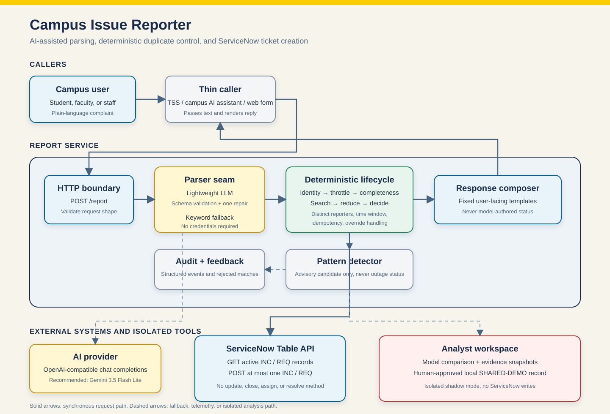

# Campus Issue Reporter

A local-development service that turns plain-language campus technology reports
into structured ServiceNow tickets and reduces duplicate incidents when several
people report the same problem.

The service uses a language model only as a parser. It extracts bounded fields
such as service, scope, location, room, and symptom. Deterministic application
code validates those fields, searches ServiceNow, decides whether to create a
ticket, and composes the user response.

## Project Status

This repository is a contained local-development project, not a production
university service.

The complete ServiceNow demonstration requires either:

- Access to the university ServiceNow REST Table API with approved credentials
  and fields, or
- A ServiceNow Personal Developer Instance (PDI) configured as described below.

AI parsing requires an API key for the LLM provider or another provider that exposes an
OpenAI-compatible `POST /chat/completions` endpoint with bearer authentication.
Use a lightweight parsing model. `gemini-3.5-flash-lite` is the recommended
starting model based on local project evaluation; rerun the included evaluation
against your provider and prompt before making a deployment choice. Another
low-latency Flash-class model can also be used.

Without AI credentials, the normal application still starts and falls back to a
deterministic keyword parser. Without ServiceNow credentials, it uses an in-memory
ticket sink. Always run `npm run snow:check` before claiming a ticket was created
in ServiceNow.

## What It Does

```text
Plain-language report
  -> bounded AI or keyword parsing
  -> schema validation and normalization
  -> ServiceNow search for active similar records
  -> deterministic create/no-create decision
  -> at most one ServiceNow ticket
```

Supported demonstration topics include campus Wi-Fi, wired networking, VPN, web
portals, and classroom audiovisual equipment.

The duplicate rule counts distinct reporter hashes, not raw submissions. Early
reports still create tickets so ITS can see emerging evidence. Once a topic's
demonstration threshold is reached, a later report links to existing tickets and
creates nothing. The reporter can reject that match and file separately.

## Architecture



The synchronous request path is intentionally narrow: callers submit text, the
parser produces bounded fields, and deterministic code owns identity, throttling,
completeness, ServiceNow search, matching, and ticket creation. ServiceNow access
is structurally limited to reading open records and creating at most one ticket.
The analyst workspace is a separate local shadow process and cannot write to
ServiceNow.

## Safety Boundaries

- ServiceNow access is read and create only.
- The application cannot close, resolve, update, reassign, escalate, comment on,
  acknowledge, or delete a ticket.
- Peer-report volume is not treated as an outage declaration.
- The model does not decide whether to create a ticket or generate status text.
- A failed ServiceNow search never falls through to ticket creation.
- A failed model call falls back to deterministic parsing.
- Demonstration identities and test data are synthetic.
- Current thresholds and in-process state are suitable for a demo, not production.

## Requirements

- Node.js 24.x
- npm
- Optional AI provider credentials
- Optional ServiceNow PDI or approved university ServiceNow Table API access

## Install

```bash
git clone <repository-url>
cd selfserviceagent
npm ci
cp .env.example .env
```

`npm ci`, the test suite, and the offline demo do not require gstack or any other
agent tooling.

## Environment

Edit `.env` and provide only the integrations you want to exercise.

### AI Parser

```dotenv
LLM_API_URL=https://your-provider.example/v1
LLM_API_KEY=replace-with-your-api-key
LLM_MODEL=gemini-3.5-flash-lite
LLM_TIMEOUT_MS=10000
```

Despite the historical `LLM_*` variable names, the parser transport only
requires an OpenAI-compatible `/chat/completions` endpoint and bearer token. The
`eval:models` token-counter measurement is provider-specific because it also calls
`/utils/token_counter` on the provider origin.

Recommended starting point:

```dotenv
LLM_MODEL=gemini-3.5-flash-lite
```

Use another Flash-class model only after running the same synthetic parser corpus.
Model availability and exact IDs depend on the configured provider.

### ServiceNow

```dotenv
SNOW_INSTANCE_URL=https://dev000000.service-now.com
SNOW_USER=admin
SNOW_PASSWORD=replace-with-your-pdi-password
SNOW_READ_SCOPE=service_owned
SNOW_TIMEOUT_MS=15000
```

Use the instance origin only, with no trailing path. The local PDI demo uses Basic
authentication over HTTPS. Production the university authentication and least-privilege
roles require separate approval and configuration.

Never commit `.env` or real credentials.

The complete annotated template is in [`.env.example`](.env.example).

## ServiceNow PDI Setup

Create these five optional String columns on the existing global `Task [task]`
table. Do not create a new table. `incident` and `sc_request` inherit the fields.

| Label | Exact column name | Type | Max length |
| --- | --- | --- | ---: |
| Campus Issue Service | `u_service` | String | 40 |
| Campus Issue Scope | `u_scope` | String | 40 |
| Campus Issue Symptom | `u_symptom` | String | 80 |
| Campus Issue Location | `u_location` | String | 255 |
| Campus Issue Reporter Hash | `u_reporter_hash` | String | 64 |

Leave each field non-mandatory, non-unique, writable, and without a default.

Verify the instance and fields:

```bash
npm run snow:check
```

This preflight reads `sys_dictionary`. A least-privilege account may be able to
create incidents but unable to inspect dictionary metadata; use an administrator
for PDI setup or have the ServiceNow owner verify the fields and ACLs.

The ServiceNow adapter uses the REST Table API:

```text
GET  /api/now/table/incident   search active peer incidents
GET  /api/now/table/sc_request search active peer requests
POST /api/now/table/incident   create an incident
POST /api/now/table/sc_request create an individual request by default
```

Created records use `correlation_display=campus-issue-reporter` so the default
`service_owned` read scope searches only records owned by this integration.

## Run The Application

### Offline CLI Demo

No credentials or network required:

```bash
npm run demo
```

### Web Application

```bash
npm run web
```

Open <http://127.0.0.1:4000/>.

The normal web app keeps one synthetic reporter identity per page load. This is a
local stand-in for authenticated campus identity.

### Presentation Mode

```bash
npm run web:presentation
```

Presentation mode rotates a clearly labelled synthetic reporter after each
accepted submission so one presenter can demonstrate the distinct-reporter
threshold from a single browser. Never use this mode as production identity.

Suggested Lecture Hall sequence with a configured, evaluated AI model:

1. `The projector in Lecture Hall will not turn on`
2. `The display equipment in Lecture Hall will not power on`
3. `Projectors across Lecture Hall are not turning on`
4. `Faculty reports that the AV equipment in Lecture Hall is unavailable`

The first three distinct reports create incidents in a fresh PDI. The fourth
returns `MATCHED_CLUSTER` and creates nothing. Select **This is not my issue - file
separately** to verify the override path.

Without AI credentials, use the same supported phrase for each submission, such
as `The projector in Lecture Hall will not turn on`, because the keyword fallback
intentionally recognizes fewer paraphrases.

Inspect matching ServiceNow records:

```bash
SNOW_CHECK_SERVICE=classroom_av \
SNOW_CHECK_SCOPE=location \
SNOW_CHECK_SYMPTOM=equipment_unavailable \
SNOW_CHECK_LOCATION="Lecture Hall" \
npm run snow:peers
```

### Experimental Analyst Demo

The analyst surface compares parser models, aggregates synthetic report evidence,
and creates a human-approved local `SHARED-DEMO-*` record for operator review. It
is loopback-only, does not create generalized ServiceNow incidents, and does not
use local shared records to bypass the normal reporter lifecycle.

It requires AI credentials:

```bash
ANALYST_OPERATOR_TOKEN="$(openssl rand -hex 24)" npm run demo:analyst
```

Open:

- Reporter: <http://127.0.0.1:4100/>
- Operator login: <http://127.0.0.1:4100/operator/login>

The process prints the bootstrap operator token. It can create one active session
at a time and becomes available again after that session expires. Sessions last
30 minutes.

## Model Evaluation

Run one model against the synthetic corpus:

```bash
npm run eval:llm
```

Compare models using the LLM provider's token counter:

```bash
ANALYST_MODELS="gemini-3.5-flash-lite,another-flash-model" \
LLM_EVAL_RUNS=3 \
npm run eval:models
```

The generated `analyst-model-benchmark.json` is ignored by Git. The benchmark
reports concrete field failures, report failures, repairs, fallbacks, provider
errors, critical grouping failures, latency, and token use. A single run is not a
production model-approval decision.

## HTTP API

The local web server exposes `POST /report`:

```bash
curl http://127.0.0.1:4000/report \
  -H 'content-type: application/json' \
  -d '{
    "text": "The projector in Lecture Hall will not turn on",
    "identityRef": "synthetic-caller-1",
    "canFollowUp": true
  }'
```

Request fields:

| Field | Type | Meaning |
| --- | --- | --- |
| `text` | string | Reporter's problem description |
| `identityRef` | string | Opaque caller identity used for hashing and throttling |
| `canFollowUp` | boolean | Whether the caller can ask for missing detail |
| `overrideMatchId` | string, optional | Existing match the reporter rejected |

Successful application outcomes return HTTP 200. Malformed, empty, or oversized
HTTP bodies return 400 with a canonical `UNAVAILABLE` response. Throttling returns
429 and an unavailable dependency returns 503. Response outcomes are
`MATCHED_DECLARED`, `MATCHED_CLUSTER`, `FILED_INCIDENT`, `FILED_REQUEST`,
`NEEDS_DETAIL`, `THROTTLED`, or `UNAVAILABLE`. Match responses include an override
handle; filed responses include the ticket number and URL returned by the ticket
sink.

## Verify

Run the complete local verification suite:

```bash
npm test
npm run build
npm run lint
npm run web:e2e
npm run demo:analyst:e2e
```

The automated tests use recorded model responses and synthetic ServiceNow
responses. They do not require credentials or network access.

Live integration checks:

```bash
npm run snow:check
npm run snow:peers
npm run snow:inspect-analyst
```

These commands require a configured and reachable ServiceNow instance.

## Project Layout

```text
src/       application core, parsers, contracts, and adapters
web/       local reporter application and HTTP smoke test
analyst/   local analyst UI, server, and HTTP smoke test
demo/      deterministic and interactive CLI demos
scripts/   live model and ServiceNow diagnostics
tests/     unit and integration tests with synthetic fixtures
```

## Current Limitations

- This is a single-process local demonstration.
- Throttling, idempotency, report events, and overrides are not in a shared
  production store.
- Production Caller, Assignment group, Channel, Service, Service offering, and
  Configuration item mappings are not implemented.
- The current demo creates `INC` for location/service-wide reports and `REQ` for
  individual reports. the university must decide whether customer intake should use Customer
  Service cases (`CS`) instead.
- Assignment routing is intentionally not implemented. A downstream ITS
  Classifier could route newly created records after the create decision.
- Generalized analyst-created ServiceNow records remain disabled.
- Production hosting, SSO, monitoring, on-call ownership, kill switch, and security
  review are outside this local project.
