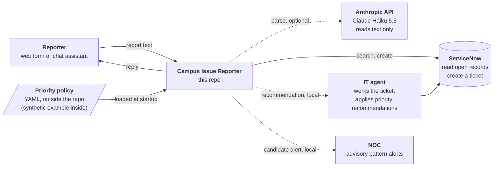
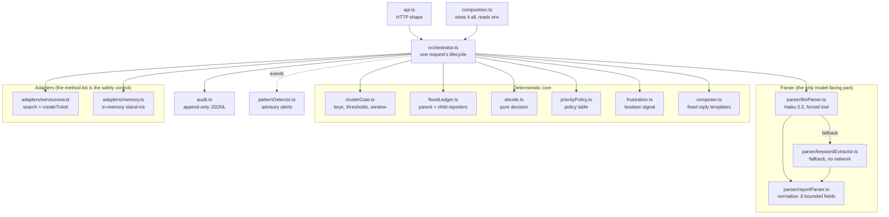

# Architecture

State after Milestone 1. The rule that shapes everything: **models only read
text; deterministic code decides.** The parser turns words into bounded fields.
Whether to create a ticket, link to one, or set a priority is decided by plain
code that a test can pin down.

## Context



Solid arrows are the request path; dashed arrows are optional or advisory.
Nothing in this service can update, close or comment on a ServiceNow record.

## Components



## Data flow: a burst of reports about one problem

```mermaid
sequenceDiagram
    participant R1 as Reporter 1
    participant R2 as Reporter 2..30
    participant O as Orchestrator
    participant P as Parser
    participant L as Flood ledger
    participant S as ServiceNow

    R1->>O: "wifi in North Residence Hall keeps dropping"
    O->>P: text
    P-->>O: {wifi, location, NORTH RESIDENCE HALL, ...}
    Note over O: identity hash, throttle,<br/>idempotency, completeness
    O->>L: queue on key wifi|NORTH RESIDENCE HALL
    L-->>O: no open parent
    O->>S: search (read)
    S-->>O: no qualifying match
    Note over O: decide → FILE_INCIDENT<br/>priorityFor(tier 2, 1 reporter) → P4, rule t2-reporters-1
    O->>S: createTicket (the one create)
    S-->>O: INC0000001
    O->>L: start parent INC0000001, reporters {R1}
    O-->>R1: FILED_INCIDENT

    R2->>O: same problem, different reporter
    O->>L: queue on the same key (waits for R1's turn to finish)
    L-->>O: open parent INC0000001
    O->>S: search (read; a declared incident would still win)
    Note over O: decide → MATCHED_CLUSTER (linked_to_parent)
    O->>L: add reporter hash; at 5 and 15 reporters the<br/>policy calls for a raise → one pending recommendation
    O-->>R2: MATCHED_CLUSTER, "a ticket is already open (INC0000001)"
```

What the 30-report burst leaves behind: one INC in ServiceNow (created at P4),
30 reporter hashes on the ledger, and one pending recommendation ("raise to
P2, policy rule t2-reporters-15") for a person to apply.

## Request lifecycle, step by step (`src/orchestrator.ts`)

1. **Parse**: `llmParser` (key set) or the keyword parser. Never throws.
2. **Identity**: salted hash of the caller's opaque reference.
3. **Throttle**: per-reporter budget, before any read load.
4. **Idempotency**: the same reporter and the same text get the same answer back.
5. **Completeness**: ask for one missing detail, or fall back to a request.
   - **5b. Flood key**: INC-class reports with a building, or service-wide reports, get a key; others skip the ledger. Reports for one key run one at a time from here.
   - **5c. Flood ledger**: is a parent open for this key? (If its create had an unknown outcome: UNAVAILABLE.)
6. **Search**: ServiceNow read, retried once; never falls through to a create.
7. **Reduce**: candidates become booleans and counts.
8. **Decide** (`decide.ts`): override > declared incident > open parent > peer threshold > file.
9. **Act**: quote a declared incident, link to the parent, or create one ticket (an INC gets its priority from the policy and becomes a parent).
10. **Fan out**: event to the advisory pattern detector.
11. **Remember**: store the answer for idempotent retries.

## Reading order for a first-time reader

1. `README.md`: what it is and the safety promises.
2. `src/contracts/types.ts`: the data shapes. `ProblemReport` has 8 fields and no decision field.
3. `src/contracts/adapters.ts`: the adapter method lists. No update method exists.
4. `src/decide.ts`: the whole decision, about 40 lines of logic.
5. `src/clusterGate.ts`: correlation keys, thresholds, the window.
6. `src/floodLedger.ts`: parents, child reporters, the per-key queue.
7. `src/priorityPolicy.ts` with `policy.example.yaml`, then `src/frustration.ts`.
8. `src/orchestrator.ts`: steps 1–11 above, in order.
9. `src/parser/llmParser.ts`, then `src/parser/reportParser.ts` and `src/parser/keywordExtractor.ts`.
10. `src/adapters/servicenow.ts`: the only code that talks to ServiceNow.
11. `src/composition.ts`: how it is wired, and which environment variables matter.
12. `tests/floodControl.test.ts` and `tests/floodScenarios.ts`: the acceptance tests.
13. `docs/DECISIONS.md`, `docs/RESULTS.md`, `docs/LEARNINGS.md`.
